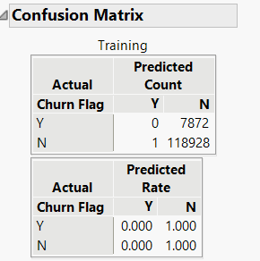
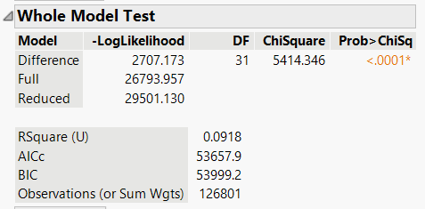
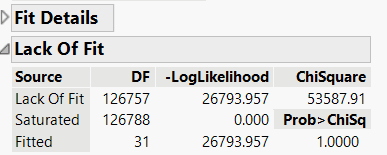
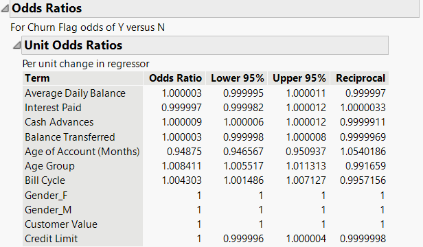

# Customer Churn Analysis

**Positioning:** Customer Analytics / Retention | **Source:** JMP project report and analysis archive

## Executive summary
The report describes 245,465 dataset observations and a nominal logistic model. The saved model output shows **126,801 training observations** and a training confusion matrix that misses every churn case. The model is statistically significant, but its training classification result does not support a useful churn-detection claim.

## Business question and pipeline
Which customer attributes are associated with churn, and which groups merit retention investigation?

## Business KPIs

The report does not provide a validated churn KPI for a defined customer population and time period. Do not treat the saved model sample as the business-wide churn rate.

| KPI | Formula | Value / status | Interpretation |
|---|---|---|---|
| Churn rate | `Customers churned during period ÷ eligible customers at period start × 100` | Not established | Requires a defined period, eligible population, and reconciled source count. |
| Retention rate | `Customers retained through period end ÷ eligible customers at period start × 100` | Not reported | Pair with churn rate using the same cohort and period definition. |
| Retention campaign impact | Treated-group outcome minus comparable-control outcome | Not measured | The report contains no retention intervention or measured business outcome. |

## Model Metrics

| Metric | Formula / definition | Reported value | Interpretation |
|---|---|---:|---|
| Source / model sample size | Count of records | **245,465** in report / **126,801** in saved model output | Population mismatch; reconcile filtering, missing-data handling, and model population. |
| Training-sample churn share | `Actual Churn=Yes ÷ model observations` | `7,872 ÷ 126,801` = **6.21%** | Applies only to the saved training confusion matrix, not a validated business KPI. |
| Accuracy | `(TP + TN) ÷ all training cases` | `118,928 ÷ 126,801` = **93.79%** | Misleading alone because the model predicts almost every case as No. |
| Churn recall | `TP ÷ (TP + FN)` | `0 ÷ 7,872` = **0%** | The matrix identifies none of the actual churn cases. |
| Churn precision | `TP ÷ (TP + FP)` | `0 ÷ 1` = **0%** | Its only predicted Yes case was not an actual churn case. |
| Odds ratios | `OR = exp(β)` | Account age **0.94875/month**; Good LTV **0.437**; Other LTV **1.292**; age group **1.00841/step**; bill cycle **1.00430/step** | Below 1 indicates lower modeled odds versus the reference; above 1 higher odds. Not probability-point changes or causal effects. |
| Cash Advances odds ratio | `exp(β)` | **1.000009**; report also states coefficient **8.87** | These do not reconcile for the same unit; validate before interpreting. |
| Whole-model test / pseudo-R² | Model test p-value; JMP `R²(U)` | **p < 0.0001**, `R²(U)=0.0918` | Indicates association in the fitted model, not useful prediction by itself. |
| Lack-of-fit test | Test p-value | **p = 1** | No lack of fit detected by this test; it does not establish generalization. |

## Insights
- Account age OR **0.94875** corresponds to about **5.13% lower modeled odds per additional month**, holding other terms constant.
- Good LTV OR **0.437** corresponds to **56.3% lower odds** than the reference group; the reference category should be named in the final analysis.
- Despite **93.79% accuracy**, the saved model has **0% churn recall**. Its accuracy comes from predicting No for almost everyone and should not be presented as successful churn prediction.
- The report says three input fields had high missingness before imputation: Age of Account **137,503 (56.0%)**, Age Group **145,970 (59.5%)**, and Gender **118,664 (48.3%)**. The model sample-size discrepancy also needs resolution.

## Recommendations
1. Reconcile the 245,465 input count with the 126,801 model output and document the final analysis population.
2. Validate the Cash Advances coefficient/OR and category reference levels.
3. Revisit classification threshold and class imbalance, then evaluate recall/precision on a separate holdout sample before claiming churn-detection value.
4. Test the imputation assumptions and sensitivity because of the large missing shares.
5. Explore retention actions for shorter-tenure and LTV groups only as hypotheses, then measure results with a controlled comparison.

## Model evidence from the report

Model significance, fit, and odds-ratio outputs

## Source data and JMP files
- **Dataset:** [Customer-Churn-Analysis.jmp](data/Customer-Churn-Analysis.jmp) — source dataset described in the report as 245,465 observations; the project owner confirmed it is cleared for public release.
- **JMP analysis journals:** [Download the journal bundle](analysis/Customer-Churn-JMP-Analysis-Journals.zip) — eight data exploration, recoding, missing-value, outlier, and nominal-logistic output journals. Extract the ZIP to open the individual `.jrn` files in JMP.
- **Report source:** The written project report supplied the metrics and selected visuals; the full report is not included.

The report does not document a formal BRD/FRD, As-Is process, or stakeholder-management approach.

## Supporting documents

- [Executive summary](docs/Executive-Summary.md)
- [Business requirements summary](docs/BRD-Summary.md)
- [Functional requirements summary](docs/FRD-Summary.md)

The source reports do not document an existing-state (As-Is) process; none is presented as fact.

